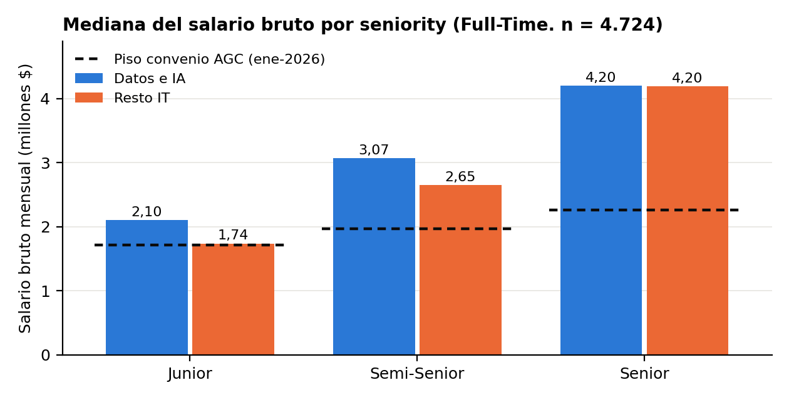
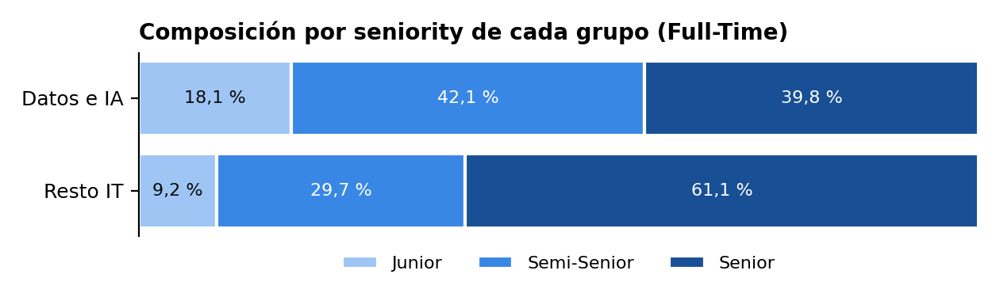
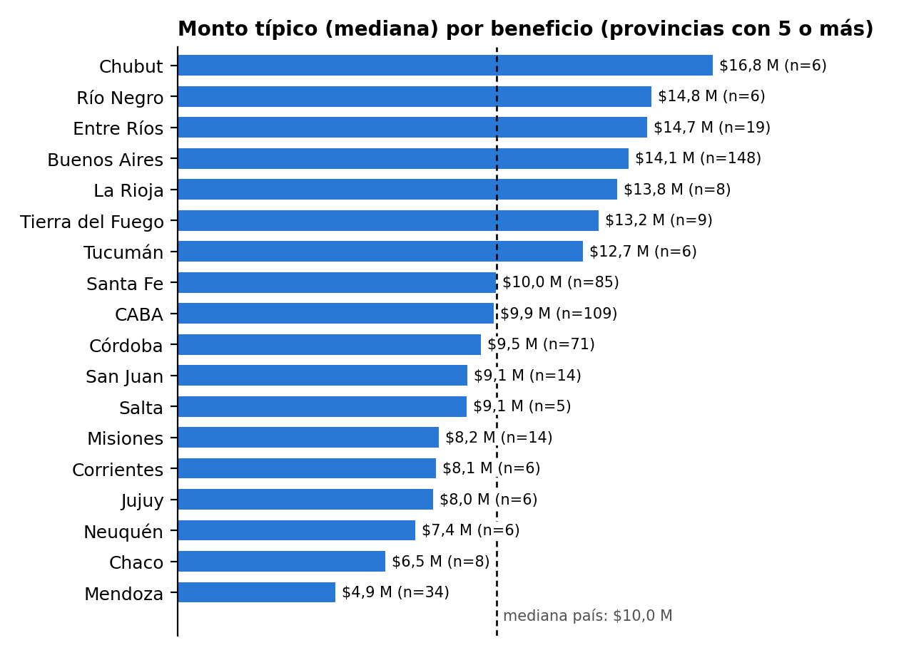
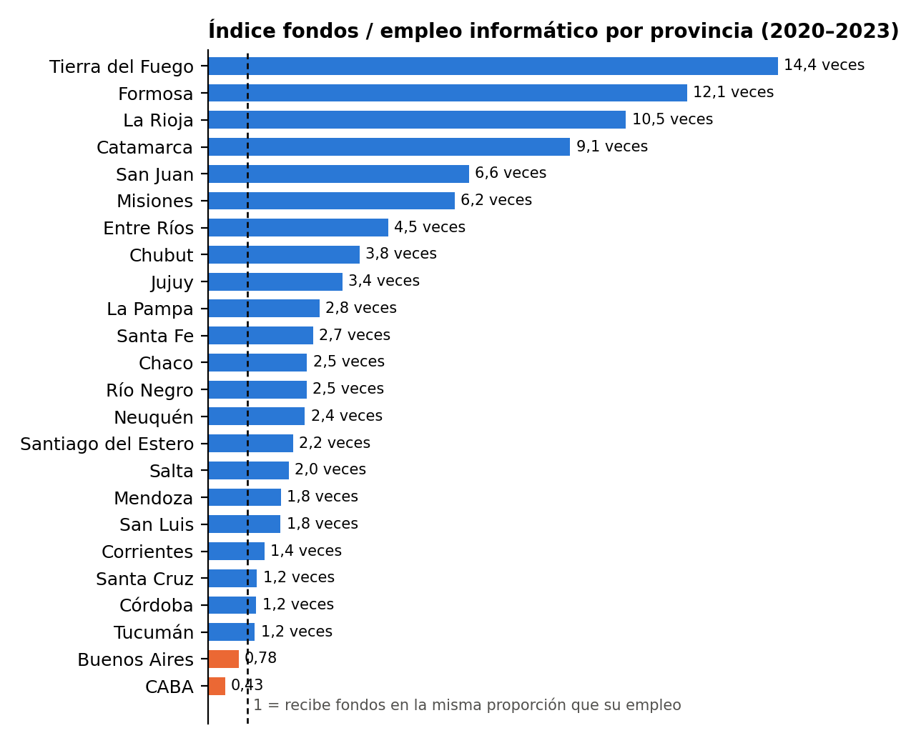
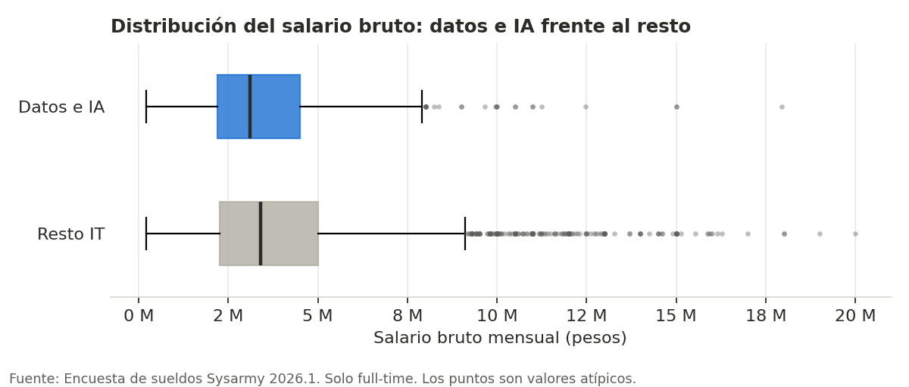
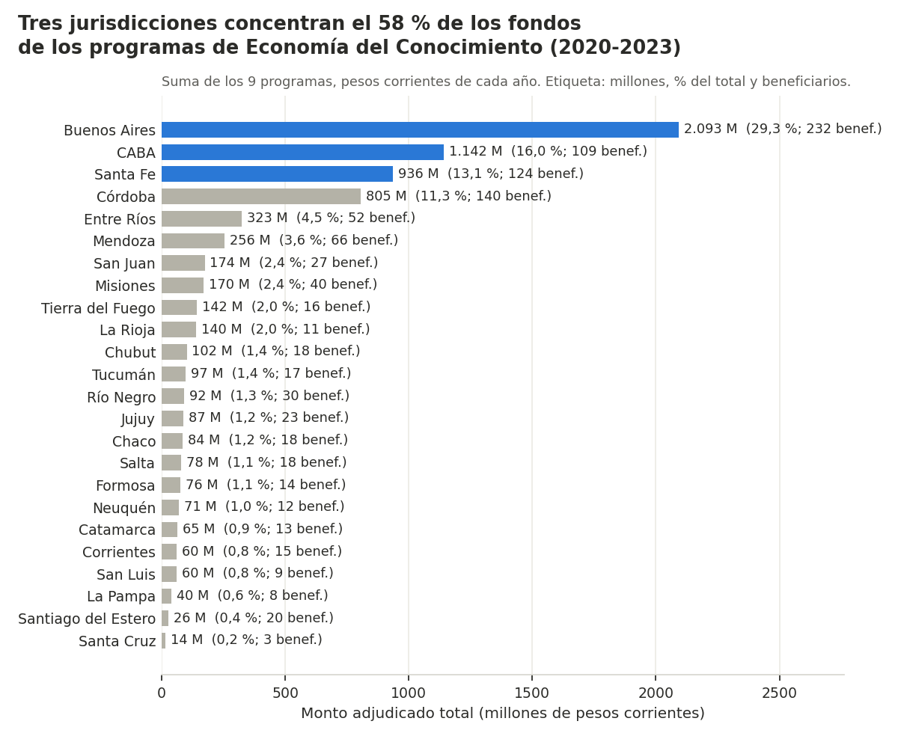
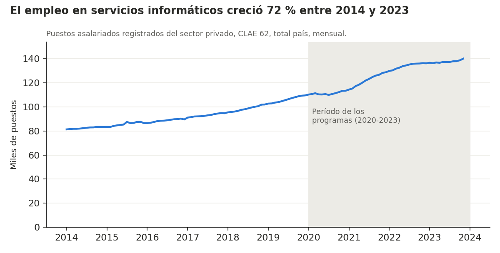
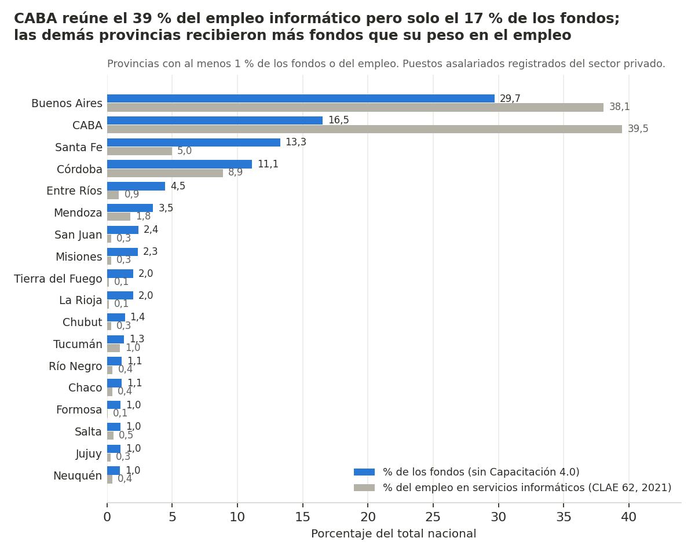

# Economía del Conocimiento en Argentina – Análisis descriptivo

**Equipo 3 - PP1 - Economía del Conocimiento - 2C - 2026**
Prácticas Profesionalizantes 1 · Tecnicatura Superior en Ciencia de Datos e IA · Politécnico Malvinas Argentinas

## Integrantes del equipo
- Jordana Escalona – Analista de Datos / Documentadora
- José Luis Martín – Diseñador de Visualizaciones
- Alejandro Suarez – Encargado de Entrega / Comunicador
- David Moreira – Coordinador de Recursos / Calidad de Datos

---

## Descripción del proyecto
La Ley 27.506 de Economía del Conocimiento promueve actividades como el software y los servicios informáticos, la industria 4.0, la inteligencia artificial, la biotecnología y el audiovisual. Este proyecto realiza un **análisis descriptivo** con datos públicos para conocer el sector desde dos ejes:

1. **Talento:** cuánto cobran los puestos vinculados a datos e inteligencia artificial frente al resto de los puestos IT.
2. **Territorio:** cómo se distribuyeron entre las provincias los fondos de los programas de promoción (2020-2023) y si coinciden con el empleo en servicios informáticos.

El análisis es descriptivo: cuenta, resume y compara. No busca explicar causas ni medir el impacto de los programas.

---

## Fuente de datos
| Dataset | Fuente | Uso |
|---|---|---|
| Encuesta de sueldos Sysarmy 2026.1 | [Sysarmy](https://sysarmy.com/blog/posts/resultados-de-la-encuesta-de-sueldos-2026-1/) | P1 |
| 9 programas de la Economía del Conocimiento (2020–2023) | [datos.gob.ar](https://datos.gob.ar) – Ministerio de Economía | P2, P3 |
| Puestos de trabajo por provincia y rama (CLAE 62) | [CEP XXI](https://datos.gob.ar/dataset/puestos-de-trabajo-por-departamento-partido-y-sector-de-actividad) | P3 |
| IPC | [INDEC](https://www.indec.gob.ar/indec/web/Nivel4-Tema-3-5-31) | P2 (pesos de 2023) |
| Población por provincia | INDEC – Censo 2022 | P2 (monto por habitante) |
| Tipo de cambio A3500 | [BCRA](https://www.bcra.gob.ar/tipo-cambio-referencia-comunicacion-a-3500-tcnpm/) | P1 (contexto) |
| Grilla del convenio AGC (enero 2026) | [informaticos.ar](https://informaticos.ar/convenios/) | P1 (validación) |
| Honorarios recomendados (09-2026) | [CPCI Córdoba](https://cpcipc.org.ar/honorarios-recomendados/) | P1 (validación) |

El programa vigente KIT 4.0 no tiene datos abiertos: se pidieron por la Ley 27.275 (ver `solicitudes/`).
Detalle, enlaces de descarga y registros de cada archivo: [`data/raw/LEEME.md`](data/raw/LEEME.md).

---

## Objetivos del análisis
**Hilo conductor:** ¿Dónde está el trabajo en datos e inteligencia artificial, cuánto vale, y los fondos públicos de la Economía del Conocimiento acompañan esa distribución?

- **P1 – Perfiles laborales + territorio:** ¿Cuánto cobran los puestos de Datos e IA frente al resto de IT, y cómo cambia esa diferencia entre CABA y el resto del país?
- **P2 – Distribución territorial de fondos:** ¿Qué provincias concentran los fondos de los programas de la Economía del Conocimiento y cuántos beneficios recibió cada una?
- **P3 – Territorio + empleo registrado:** ¿Los fondos se distribuyen en proporción al empleo informático registrado de cada provincia?

El análisis es descriptivo y comparativo: muestra qué pasa en los datos, no sus causas.

---

## Herramientas utilizadas
- **Python** (pandas, matplotlib): EDA inicial (Sprint 1) y EDA Sprint 2, en notebooks ejecutables en Google Colab
- **OpenRefine**: limpieza de Sysarmy, programas y CPCI, con recetas JSON reproducibles – Sprint 2
- **Pentaho Data Integration**: unión de los 9 programas y transformación del CEP XXI – Sprint 2
- **Power BI**: modelo estrella con dim_provincia (Sprint 2) y dashboard final (Sprint 3)
- Excel / CSV, Google Drive, Trello, GitHub y GitHub Desktop (ramas y pull requests), Google Meet y WhatsApp

---

## Proceso de análisis
- **Sprint 1 (completado):** organización del equipo, ficha de conocimiento del dominio, preguntas de análisis, diccionario de datos y EDA inicial sobre los datos originales.
- **Sprint 2 (completado):** limpieza y transformación (ETL) con OpenRefine y Pentaho según los problemas detectados en el EDA, integración por provincia (provincia_id), datasets complementarios, validación de salarios con tres fuentes, modelo base en Power BI, EDA Sprint 2 y reporte de insights.
- **Sprint 3:** visualización en Power BI, data storytelling y presentación final.

### Cómo reproducir el EDA
```bash
pip install -r requirements.txt
python analysis/eda_sprint1.py
```
Antes, copiar en `data/raw/` el archivo del CEP XXI, que no está en GitHub por su tamaño (ver [`data/raw/LEEME.md`](data/raw/LEEME.md)). El script genera `reports/sprint1/eda_resumen.xlsx` y los gráficos de `reports/sprint1/graficos/`.

**EDA Sprint 2:** [`analysis/eda_sprint2.ipynb`](analysis/eda_sprint2.ipynb) · [](https://colab.research.google.com/drive/1_4VTmtrcp5sCaBpBqJgX3_5VcBdsjKus)

Documento del EDA Sprint 2: [`reports/sprint2/PP1-S2-EDA-Sprint2.pdf`](reports/sprint2/PP1-S2-EDA-Sprint2.pdf) · Modelo de Power BI: [`reports/sprint2/EQ3_PP1_modelo.pbix`](reports/sprint2/EQ3_PP1_modelo.pbix)

---

## Resultados principales
*Sprint 2 (datos limpios, indicadores relativos):*
- **P1:** a igual seniority, Datos e IA cobra igual o más que el resto de IT (+20,9 % Junior, +15,8 % Semi-Senior); la mediana total es menor por efecto composición. La ventaja se mantiene fuera de CABA.
- **P2:** por habitante (pesos de 2023), Tierra del Fuego ($2.326), CABA ($1.188) y La Rioja ($1.000) superan el promedio nacional ($497); Buenos Aires queda por debajo ($399).
- **P3:** 22 de las 24 provincias reciben fondos por encima de su peso en el empleo informático; solo CABA (índice 0,43) y Buenos Aires (0,78) reciben menos.

*Observaciones iniciales del Sprint 1:*
- Los puestos de datos e IA son el 8,9 % de las respuestas de Sysarmy. Su mediana salarial total es algo menor que la del resto ($3,10 M frente a $3,40 M, full-time), posiblemente porque el grupo tiene menos personas senior.
- Los 9 programas otorgaron 1.035 beneficios por $7.133 M (pesos corrientes) entre 2020 y 2023 y llegaron a las 24 jurisdicciones; Buenos Aires, CABA, Santa Fe y Córdoba reúnen cerca del 70 %.
- Las provincias con más fondos son también las de más empleo informático, pero las proporciones no coinciden: CABA y Buenos Aires tienen una parte del empleo mayor que su parte de los fondos.
- **Calidad de datos:** nombres de provincia y de columnas distintos entre archivos, montos en pesos de distintos años, valores protegidos (-99) en el CEP XXI y valores imposibles en algunas variables de Sysarmy. Se corrigieron en el ETL del Sprint 2.

---

## Visualizaciones

### EDA Sprint 2

**P1 – Mediana del salario por seniority y piso del convenio AGC**


**P1 – Composición por seniority (efecto composición)**


**P2 – Monto típico por beneficio**


**P3 – Índice fondos / empleo informático**


### EDA inicial (Sprint 1)





---

## Conclusiones
Se completarán en el Sprint 3.

---

## Estructura del repositorio
```
├── README.md
├── requirements.txt
├── data/
│   ├── raw/          → datos originales sin modificar (+ LEEME.md con las fuentes)
│   └── processed/    → datos limpios (Sprint 2)
├── analysis/
│   ├── eda_sprint1.py                     → script del EDA inicial
│   ├── eda_sprint2.ipynb                  → notebook del EDA Sprint 2
│   ├── unir_programas.ktr                 → Pentaho: unión de los 9 programas
│   ├── cep_empleo.ktr                     → Pentaho: empleo por provincia (CEP XXI)
│   ├── validacion_salarios_sysarmy.ipynb  → validación de salarios (CEP XXI y convenio AGC)
│   └── evidencia_comparativa_salarios.jpeg → gráfico de la validación de salarios
├── solicitudes/      → pedido de datos de KIT 4.0 (Ley 27.275)
├── docs/
│   ├── PP1-S1-Ficha-Conocimiento-del-Dominio.docx
│   ├── PP1-S1-Preguntas-de-analisis.docx
│   └── PP1-S1-Diccionario-de-Datos.xlsx
└── reports/
    ├── sprint1/
    │   ├── PP1-S1-EDA-Inicial.docx
    │   ├── PP1-S1-Ficha-Seguimiento-Sprint.docx
    │   ├── eda_resumen.xlsx
    │   └── graficos/
    └── sprint2/
        ├── PP1-S2-EDA-Sprint2.pdf
        ├── EQ3_PP1_modelo.pbix   → modelo base de Power BI
        └── graficos/             → gráficos del EDA Sprint 2
```
